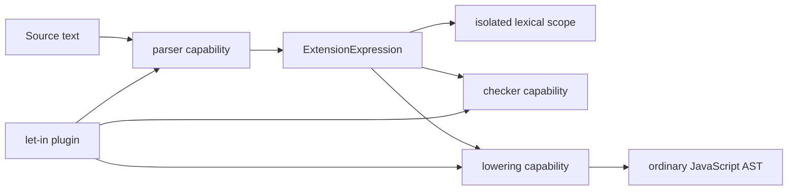

# TSPP plugin framework

The plugin framework grows from concrete capsules. The first compiler port is
an expression-syntax port proven by the independently packaged `let-in` plugin.

```mermaid
flowchart LR
    PluginA[plugin package A] --> SDK[@tspp/plugin-sdk]
    PluginB[plugin package B] --> SDK
    SDK --> Registry[compiler static registry]
    Registry --> Compiler[TSPP compiler]
    LetIn[let-in package] --> SDK
    Registry --> LetIn

    PluginA -. no direct import .- PluginB
```

## Package boundary

- `@tspp/plugin-sdk` owns public plugin contracts and reusable host validation.
- `ts-plus-plus` owns the static composition root in
  `src/compiler/plugins/registry.ts`.
- each plugin lives in its own package under `packages/plugins/`.
- plugin packages depend on the SDK, never compiler internals or another plugin
  implementation.
- the compiler injects narrow capability ports into the activating plugin, so
  static composition does not create a compiler/plugin package cycle.

## What exists now

- stable plugin IDs and package versions;
- an explicit plugin API version;
- registration before activation;
- deterministic activation order and reverse cleanup;
- duplicate-ID and API-version checks;
- rollback when activation fails;
- one static compiler registry initialized at the compiler composition root;
- a generic `ExtensionExpression` AST envelope owned by the compiler;
- token-indexed expression parsing, checking, and lowering ports;
- lexical isolation and normal traversal for extension expressions;
- `@tspp/plugin-let-in-expression` as the first real plugin package.

## Expression capsule boundary



The compiler knows only the plugin ID and ordered child nodes. The plugin owns
the syntax lookahead, child meaning, result type, and lowering strategy. For
`let x = value in body`, the two children are the declaration list and body;
lowering produces a zero-argument arrow IIFE.

## What deliberately does not exist yet

- runtime package discovery;
- configuration-file loading;
- statement, declaration, type-syntax, emitter, or language-service ports;
- plugin-to-plugin service lookup;
- ordering and dependency declarations.

Each next plugin should add only the smallest new compiler port it needs.
Adding a port without a real consumer would turn speculation into permanent API
surface.
