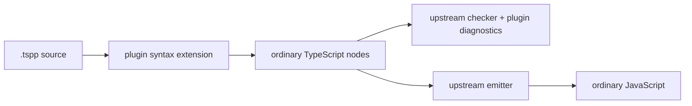
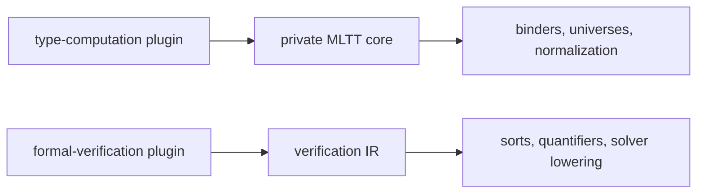

# TSPP feature plugin framework

TSPP features are complete capsules. Feature-specific compiler, language
service, LSP, and editor code belongs to the feature package; core packages own
only loading, composition, transport, and stable SDK contracts.

```mermaid
flowchart LR
    Config[tsconfig.json plugins] --> Resolver[package resolution]
    Resolver --> CompilerHost[compiler facet host]
    Resolver --> LSHost[language-service facet host]
    Resolver -.-> LSPHost[optional future LSP facet host]
    Resolver --> EditorBuild[optional editor contribution builder]

    Feature[feature package] --> SDK[@tspp/plugin-sdk]
    Feature --> CompilerHost
    Feature --> LSHost
    Feature -. optional .-> LSPHost
    Feature --> EditorBuild

    CompilerHost --> Compiler[TSPP compiler]
    LSHost --> Server[TSPP tsserver]
    LSPHost --> LSP[typescript-language-server]
    EditorBuild --> Editor[VS Code extension]
```

## Ownership rule

> Feature code belongs to the feature package, shared mechanisms belong to the
> core, integration shapes belong to the SDK, and loading and composition belong
> to the host.

A feature package may expose four facets:

- `compiler`: parsing, checking, diagnostics, and lowering;
- `languageService`: feature-specific synchronous semantic contributions not
  already derived by the standard TypeScript language service; Quick Info is
  the first concrete port;
- `lsp`: reserved for capabilities that cannot be represented by tsserver; no
  current feature needs this escape hatch;
- `editor`: optional editor metadata: grammars, keywords, and views. An artifact
  view names a kind of analysis artifact; an overlay view reads a program for text
  that stands in for ranges of a file. Hosts turn views into commands, output tabs,
  and hovers, so no host knows which plugin a view belongs to.

Plugins depend on `@tspp/plugin-sdk` and on the public TypeScript API the host
hands them as `context.ts`, never on compiler internals, a TypeScript package of
their own at run time, or another feature implementation. Hosts load only the
facet they own.

Plugin syntax exists only in `.tspp` and `.d.tspp` files. The host enforces this
at every slot: `.ts`, `.d.ts`, and JavaScript files are plain TypeScript, whatever
plugins the project has active.

## Syntax ownership

Plugins stay additive because the host knows which plugin each piece of source
belongs to, and nothing depends on the order plugins were loaded in:

- **Claims.** A syntax extension lists its `keywords`, a preprocessor its `claims`,
  and an interface member binding its `keywords`. The host refuses a second
  plugin's claim on the same word in the same position at activation, and refuses
  to parse when two plugins' `isStart` both accept the same token. Manifests repeat
  the claims for editor builds that do not activate plugins, and
  `integration/test/relations.test.cjs` checks that the two agree.
- **Ownership.** The host records which plugin parsed each syntax node and which
  plugin rewrote each span of projected text.
  `getTSPPSyntaxOwners` answers from those two records, innermost plugin first.
- **Dispatch.** `filterDiagnostic` only sees diagnostics inside its plugin's syntax.
  `restoreDeclaration` and `restoreCompatibilityDeclaration` answer only for their
  plugin's nodes, and at most one plugin may answer for any other node. Quick Info
  asks the owners first, then the other plugins by id, and tells each provider
  whether it owns the position (`request.owned`).
- **Order.** Preprocessors, their declaration restorers, diagnostic providers,
  rebuilders, analyzers, and type extensions run in plugin id order, not load order.

## Project declaration

The first vertical slice uses the existing `compilerOptions.plugins` array as
the single executable capability declaration:

```json
{
  "compilerOptions": {
    "plugins": [
      {
        "name": "@tspp/plugin-modern-syntax",
        "tspp": true
      }
    ]
  }
}
```

The `tspp` marker distinguishes a feature capsule from an ordinary TypeScript
language-service plugin. Both the TSPP compiler CLI and TSPP tsserver resolve that package from the
project. The compiler activates its compiler facet before parsing project source
files. Tsserver activates the compiler and language-service facets before
constructing the configured project. Ordinary TypeScript language-service
features operate on the resulting AST, symbols, and types, while feature-owned
Quick Info flows through the same request the generic LSP bridge translates.

`typescript-language-server` remains a generic LSP-to-tsserver bridge and the
VS Code extension remains a generic client. Neither contains a modern-syntax branch.

## First feature capsule

`@tspp/plugin-modern-syntax` proves the compiler boundary. It owns the
lookahead, parse shape, type result, and lowering of `let x = value in body`
and completion-valued `do` blocks. It also owns `use pattern <- target` while
the SDK supplies the reusable trailing-closure binding mechanism: a standard
block-scoped binding plus out-of-band target metadata. The ordinary binder
still owns scope and destructuring; completion checking and lowering consume
the metadata without adding a feature-specific syntax kind.

The same capsule implements `def` through the SDK's deep-readonly binding
boundary. The parser produces an ordinary `const` declaration, while
out-of-band ownership makes its initializer a recursive const-inference
context. Emission therefore has zero runtime machinery.
Syntax plugins desugar while parsing: the parser hands them a cursor with its
own factory, and they return ordinary TypeScript nodes that the upstream binder,
checker, and emitter process unchanged.



A trailing-closure binding turns the remainder of the enclosing completion
block into a callback:

```text
use value <- acquire(arg); rest(value)
        ↓
return acquire(arg, value => { return rest(value); })
```

## Rules

- no feature ID conditionals in compiler, tsserver, LSP, or editor code;
- no plugin-to-plugin implementation imports, and no plugin spelling another's id
  or keywords, even in a string or a regular expression (`getSyntaxKeywords` answers
  what a plugin needs to know about active syntax);
- no compiler-internal imports from feature packages;
- registrations return disposers and are owned by a host lifecycle;
- duplicate IDs and incompatible API versions fail at activation;
- required and optional capsule relationships and provided APIs are manifest
  data;
- plugin packages are resolved from the declaring project;
- standard language-service behavior is reused instead of reimplemented;
- new SDK ports require a concrete feature consumer.

## Asynchronous program analysis

Complex features register a `TSPPProgramAnalyzer`. The compiler hands it the
authored text of the root source files and awaits analyzers before choosing the
CLI exit status. An analyzer never receives a `Program`, checker, compiler node,
host, or filesystem capability.

`@tspp/plugin-formal-verification` is the first consumer. It owns proof-point
discovery, SMT lowering, Z3 worker isolation, timeouts, and diagnostics; the
compiler owns only scheduling and diagnostic transport. It parses each file with
the host's parser (`context.ts.createSourceFile`), so every active plugin's syntax
is already lowered to ordinary TypeScript. It models that TypeScript, immediately
invoked functions and conditional expressions included, and knows no other plugin
except through the optional nominal-types ADT API.

### Length-preserving source projections

Syntax that can be erased before ordinary TypeScript parsing uses a registered
source preprocessor. A preprocessor may replace characters but must preserve
the exact UTF-16 length and every line break. The host retains the original text
for plugin analysis while the upstream parser, checker, language service, and
emitter see the projection. This lets formal contracts remain entirely inside
their feature capsule without adding contract-specific AST fields to TypeScript.

Every preprocessor receives the authored text and the host merges the results, so
none sees another's work. Where two rewrite the same text differently, the first
by plugin id keeps it and the file gets a diagnostic. Preprocessors search through
`maskNonCode` from the SDK, so strings and comments are never taken for syntax.

Tsserver caches analyzer results per `Program`. Completion of an asynchronous
analysis requests the existing project diagnostic refresh; the generic LSP
bridge then publishes the merged semantic diagnostics normally.

Analyzers may attach `TSPPAnalysisArtifact` values to their diagnostic array.
Artifacts are immutable, compiler-neutral text outputs identified by source
location, language, name, and status. The compiler caches them per `Program`
without interpreting their contents. The generic VS Code command **TS++: Show
Analysis Artifacts** rebuilds the active project, runs its configured analyzers,
and opens the current file's artifacts beside the source. Formal verification
uses this seam for replayable SMT-LIB and dependent types publish normalized
MLTT forms without adding feature branches to the compiler or editor.

## Tooling and observability

The VS Code client exposes generic views for active capsule manifests, projected
TypeScript, and analyzer artifacts. It does not import feature implementations.
Feature packages declare grammars and views in their `editor` facet;
`scripts/build-plugin-grammar.mjs` merges them into the files the extension ships
and checks that `package.json`, which VS Code reads first, repeats each command. All
runtime data crosses compiler-neutral SDK shapes. The playground reads the same
views for its output tabs and hovers, and finds the plugins through its package
dependencies.

The browser playground starts a fresh Web Worker whenever its selected capsule
set changes. That makes the current process-wide parser boundary explicit and
prevents registrations from one configuration leaking into another. A host may
still need an adapter for what only it can supply: the playground runs Z3 in a
browser worker and evaluates macro modules itself, which are the only places a host
names a plugin.

A rebuilder that parses in another thread loads the plugins named by
`request.pluginModulePaths` first, because a project's text holds every active
plugin's syntax. The compile-time macro worker is the first consumer.

## What keeps plugins additive

- `integration/test/cli-matrix.test.cjs` runs every plugin alone, every pair, every
  set without one plugin, and all of them through the real command line, and each
  must keep reporting its own errors. Describing a new plugin there is required: the
  test fails otherwise, and every combination then follows.
- `integration/test/boundaries.test.cjs` scans the strings and regular expressions
  of plugins and hosts for other plugins' ids and keywords, which ESLint cannot see.
- `integration/test/composition.test.cjs` holds the interactions worth stating by
  hand, such as a `match` inside a section or a contract over a lowered `do`.

## Semantic kernels are not one universal IR

Feature capsules may extract a pure semantic kernel when more than one host
surface needs the same algebra. That does not imply that unrelated algebras
belong in a single shared package.




The type-computation package's private MLTT core owns the Martin-Löf term IR, de Bruijn operations,
normalization, definitional equality, and bidirectional checking. It has no
compiler, SDK, editor, or solver dependency. The surrounding feature owns
source syntax and translates into that kernel through opaque external terms.

The kernel remains an internal module until a second concrete consumer justifies
extracting a package. The verification IR used by Z3 is deliberately separate. It represents
first-order solver formulas rather than dependent terms. Sharing utilities is
allowed when real duplication appears; merging the two semantic models merely
because both are called “IR” is not.

Terms of the theory lower as they are parsed. An alias annotation `type X: K = ...`
is read as a kind when it can be (`Type => Type`) and as a term otherwise (`Nat`);
a binder `(x: A) ->` or a built-in name such as `Nat`, in any type position, starts a
term. `src/lower.ts` turns a term into ordinary type nodes: naturals into literals,
Pi types into generic signatures, and a `match` into a conditional type, so
TypeScript decides it whether or not a binder is still open. There is no fallback
to `any`. Kind equality is the kernel's definitional equality, which lets a kind be
a term: `Vec: Nat => Type`. The kernel's errors are reported by a diagnostic
provider, like the checker's, and the analyzer publishes normal forms and warns
where a term has no TypeScript type. Names in a term resolve through the checker
when it is checked, so a term sees aliases of other files; when a term needs one to
compute, its value is worked out then, if it is a natural or a boolean. The kernel
never calls two different TypeScript types apart, so it cannot contradict
TypeScript's decision on a `match`.
`reify T` desugars to a descriptor object whose static type carries `T` in a
phantom property, and expression-level `typecase` desugars to a call whose
overloads are its arms, so TypeScript's overload resolution selects the arm and
infers its captures. A program rebuild without replacements adds the emit
transformer that keeps only the selected arm. The host has no MLTT feature IDs
or operations; the plugin owns its syntax, kernel, and editor grammar.

### Declaration extensions

Declaration plugins register a syntax extension at the `declaration` position
and return ordinary upstream declaration nodes built with the parser's factory.
The host records plugin ownership out of band; the binder, checker, and
transformers process the lowered declarations unchanged, and the extension's
`restoreDeclaration`/`restoreCompatibilityDeclaration` give the text of
`.d.tspp` and compatible `.d.ts` output.

### Plugin-owned diagnostics and checks

Plugins report diagnostics with their own codes and messages; the core has no
plugin message in `diagnosticMessages.json`. The parser cursor's `parseErrorAt`
and the type host's `error` take the plugin's code (18086 when it passes none),
and diagnostic providers build `Diagnostic` objects themselves. A check that
needs the checker's relations, such as the static side of `implements` for
static interface members, runs in a diagnostic provider through
`TSPPTypeOperations`: binding `this`, anonymous object and intersection types,
and the error the checker would report for an assignment, with its
elaboration. The type extension host offers the same operations.

## Core modification rules

The compiler package stays as close to upstream TypeScript as possible
(docs/core-restoration-plan.md). Against the upstream baseline (the
`tspp-core-baseline` tag):

1. **Only slot call sites.** Every change to an upstream file is a call site of a
   registered slot and carries the marker `// TSPP-SLOT(<slot>)` on an added
   line. Call sites forward to the slot implementation in one or a few lines.
   JSON has no comments, so a diagnostic message added for a slot carries the
   marker in a `"tsppSlot"` field.
2. **Implementations live in new files.** Slot implementations, the plugin
   registry, and product-layer logic live in `packages/compiler/src/compiler/tspp/`,
   `services/tspp/`, and `server/tspp/`.
3. **No upstream restructuring.** Upstream signatures, names, order, formatting,
   and comments stay as they are; extra data goes in `WeakMap` side tables, not
   in new fields on upstream nodes.
4. **No new `SyntaxKind`s.** Plugins lower their syntax to ordinary nodes.
5. **`.ts` means upstream.** With or without plugins, `.ts` files compile exactly
   as upstream: no new keywords, no new syntax.
6. **Slot admission.** A new slot must be describable without naming a feature,
   have an existing plugin that uses it immediately, and explain why existing
   slots or desugaring to plain TypeScript cannot do the job. It is registered in
   the table below when it lands.
7. **Plugin relationships only through manifests.** The only lasting relationship
   between plugins is a one-way dependency declared in the manifest and used
   through the provider's API.

`node scripts/core-diff.mjs` (`pnpm core-diff`) reports the changed lines per
upstream file and lists hunks without a marker. CI runs it with `--check`
(`pnpm core-diff:check`), which fails on an unmarked hunk, on a hunk too long to
be a call site, on a new file outside the `tspp/` directories, or when the changed
lines exceed the budget in the script. Lower the budget when the core shrinks; raising it needs the same review
as a new slot.

## Slot registry

Feature slots are what plugins register with, through `context.compiler` (or
`context.languageService` for Quick Info). The host implementation lives in
`compiler/tspp/registry.ts` unless noted. Call sites are in
`packages/compiler/src`; `parser.ts` means `compiler/parser.ts` and so on.

| Slot | Registration | Host | Call sites |
|---|---|---|---|
| `source-projection` | `registerSourcePreprocessor` (`preprocess`, `restoreTypeAliasDeclaration`, `restoreFunctionPrefix`, `restoreFunctionClause`) | `registry.ts`, `compiler/tspp/emit.ts` | `parser.ts` (`parseSourceFile` projects the text); `emitter.ts` (text restored before `function`, after the parameters, and in type aliases of declaration output); `services/findAllReferences.ts` (`getImplementationsAtPosition` on removed text) |
| `syntax-extension` | `registerSyntaxExtension` (positions `expression`, `primary-expression`, `argument`, `statement`, `function-body`, `declaration`, `type`, `postfix-type`, `type-parameter-annotation`, `type-alias-annotation`; `restoreDeclaration`, `restoreCompatibilityDeclaration`) | `registry.ts`, `services/tspp/syntax.ts` | `parser.ts` (the cursor, each position, list expansion, no incremental reuse of plugin nodes); `emitter.ts` (restored declarations); `services/services.ts` (`createChildren`); `services/formatting/formatting.ts`; `services/codefixes/fixUnusedIdentifier.ts`; `services/codefixes/inferFromUsage.ts` (a parameter that shares its reference's position); `utilities.ts` (`getErrorSpanForNode`), `services/utilities.ts`, `services/findAllReferences.ts`, `services/documentHighlights.ts` (nodes built without a source position stand for their parent) |
| `diagnostics` | `registerDiagnosticProvider` (`getSemanticDiagnostics`, which also receives the checker's `TSPPTypeOperations`, and `filterDiagnostic`) | `registry.ts`, `compiler/tspp/types.ts` | `program.ts` (semantic and suggestion diagnostics) |
| `interface-member-binding` | `registerInterfaceMemberBinding` (`isStaticMember`) | `registry.ts` | `binder.ts` (bound outside the instance type); `checker.ts` (static name resolution, modifier grammar); `utilities.ts` (`createNameResolver`) |
| `program-rebuild` | `registerProgramRebuilder` | `compiler/tspp/rebuild.ts` | `program.ts` (`createProgram` return); `types.ts` (`CompilerHost.invalidateTSPPProgram`); `services/services.ts` and `services/types.ts` (invalidation and rebuild on the next request); `server/project.ts` and `server/session.ts`; `resolutionCache.ts` |
| `program-analysis` | `registerProgramAnalyzer` | `compiler/tspp/analysis.ts` | none of its own: runs from the `command-line` and `plugin-host` call sites |
| `type-extension` | `registerTypeExtension` | `compiler/tspp/types.ts` | `checker.ts` (host creation, which also serves diagnostic providers, `getTypeFromTypeNodeWorker`, `instantiateTypeWorker`, the type node builder, `isTypeParameterPossiblyReferenced`) |
| `quick-info` | `languageService.registerQuickInfoProvider` | `services/tspp/quickInfo.ts` | `services/services.ts` (`getQuickInfoAtPosition` of the language service object) |

Product-layer slots belong to the host; no plugin registers with them:

| Slot | Implementation | Call sites |
|---|---|---|
| `tspp-extension` (`.tspp` sources and `.d.tspp` declarations) | `compiler/tspp/files.ts` | `types.ts` (`Extension.Tspp`); `utilities.ts` (extension tables, script kind, declaration extensions); `program.ts`; `checker.ts`; `moduleSpecifiers.ts`; `moduleNameResolver.ts` (`extensionIsOk`); `services/stringCompletions.ts`; `server/project.ts` (`hasNoTypeScriptSource`) |
| `module-resolution` (`.tspp`/`.d.tspp` resolution, `tsppTypes`, the `tspp-types` condition) | `compiler/tspp/files.ts` | `moduleNameResolver.ts` |
| `declaration-output` (a compatible `.d.ts` beside each `.d.tspp`) | `compiler/tspp/emit.ts`, `compiler/tspp/files.ts` | `emitter.ts`; `program.ts` (`verifyEmitFilePath`); `types.ts` (`PrinterOptions`) |
| `command-line` (branding, plugins from tsconfig, one-shot compilations that wait for rebuilders and analyzers) | `compiler/tspp/commandLine.ts` | `executeCommandLine.ts`; `tsc/tsc.ts`; `_namespaces/ts.ts` |
| `plugin-host` (the registry, plugin activation in tsserver) | `compiler/tspp/registry.ts`, `server/tspp/project.ts` | `_namespaces/ts.ts`; `types.ts` (`PluginImport.tspp`); `server/project.ts` (`enableProxy`) |

## Current process boundary

Compiler syntax registration is process-wide because the upstream TypeScript
parser is process-global. The first slice therefore supports one accumulated
feature set per tsserver process. True project isolation requires the LSP host
to group projects by plugin set and run separate tsserver processes, or a later
compiler change that threads a plugin context through parsing. This limitation
is explicit; feature packages themselves must not work around it with globals.
