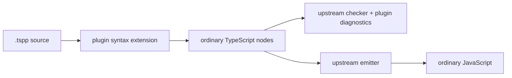
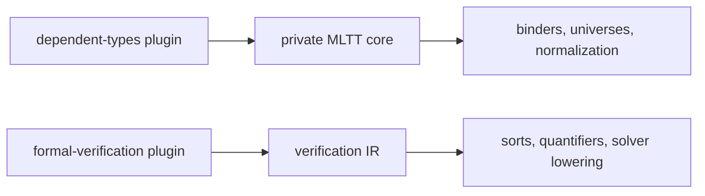

# TSPP feature plugin framework

TSPP features are complete capsules. Feature-specific compiler, language
service, LSP, and editor code belongs to the feature package; core packages own
only loading, composition, transport, and stable SDK contracts.

```mermaid
flowchart LR
    Config[tsconfig.json plugins] --> Resolver[package resolution]
    Resolver --> CompilerHost[compiler facet host]
    Resolver --> LSHost[language-service facet host]
    Resolver -.-> LSPHost[optional future LSP facet host]
    Resolver --> EditorBuild[optional editor contribution builder]

    Feature[feature package] --> SDK[@tspp/plugin-sdk]
    Feature --> CompilerHost
    Feature --> LSHost
    Feature -. optional .-> LSPHost
    Feature --> EditorBuild

    CompilerHost --> Compiler[TSPP compiler]
    LSHost --> Server[TSPP tsserver]
    LSPHost --> LSP[typescript-language-server]
    EditorBuild --> Editor[VS Code extension]
```

## Ownership rule

> Feature code belongs to the feature package, shared mechanisms belong to the
> core, integration shapes belong to the SDK, and loading and composition belong
> to the host.

A feature package may expose four facets:

- `compiler`: parsing, checking, diagnostics, and lowering;
- `languageService`: feature-specific synchronous semantic contributions not
  already derived by the standard TypeScript language service; Quick Info is
  the first concrete port;
- `lsp`: reserved for capabilities that cannot be represented by tsserver; no
  current feature needs this escape hatch;
- `editor`: optional static editor metadata such as commands and snippets.

Plugins depend on `@tspp/plugin-sdk`, never compiler internals or another
feature implementation. Hosts load only the facet they own.

## Project declaration

The first vertical slice uses the existing `compilerOptions.plugins` array as
the single executable capability declaration:

```json
{
  "compilerOptions": {
    "plugins": [
      {
        "name": "@tspp/plugin-modern-syntax",
        "tspp": true
      }
    ]
  }
}
```

The `tspp` marker distinguishes a feature capsule from an ordinary TypeScript
language-service plugin. Both the TSPP compiler CLI and TSPP tsserver resolve that package from the
project. The compiler activates its compiler facet before parsing project source
files. Tsserver activates the compiler and language-service facets before
constructing the configured project. Ordinary TypeScript language-service
features operate on the resulting AST, symbols, and types, while feature-owned
Quick Info flows through the same request the generic LSP bridge translates.

`typescript-language-server` remains a generic LSP-to-tsserver bridge and the
VS Code extension remains a generic client. Neither contains a modern-syntax branch.

## First feature capsule

`@tspp/plugin-modern-syntax` proves the compiler boundary. It owns the
lookahead, parse shape, type result, and lowering of `let x = value in body`
and completion-valued `do` blocks. It also owns `use pattern <- target` while
the SDK supplies the reusable trailing-closure binding mechanism: a standard
block-scoped binding plus out-of-band target metadata. The ordinary binder
still owns scope and destructuring; completion checking and lowering consume
the metadata without adding a feature-specific syntax kind.

The same capsule implements `def` through the SDK's deep-readonly binding
boundary. The parser produces an ordinary `const` declaration, while
out-of-band ownership makes its initializer a recursive const-inference
context. Emission therefore has zero runtime machinery.
Syntax plugins desugar while parsing: the parser hands them a cursor with its
own factory, and they return ordinary TypeScript nodes that the upstream binder,
checker, and emitter process unchanged.



A trailing-closure binding turns the remainder of the enclosing completion
block into a callback:

```text
use value <- acquire(arg); rest(value)
        ↓
return acquire(arg, value => { return rest(value); })
```

## Rules

- no feature ID conditionals in compiler, tsserver, LSP, or editor code;
- no plugin-to-plugin implementation imports;
- no compiler-internal imports from feature packages;
- registrations return disposers and are owned by a host lifecycle;
- duplicate IDs and incompatible API versions fail at activation;
- required, optional, and conflicting capsule relationships are manifest data;
- plugin packages are resolved from the declaring project;
- standard language-service behavior is reused instead of reimplemented;
- new SDK ports require a concrete feature consumer.

## Asynchronous program analysis

Complex features register a `TSPPProgramAnalyzer`. The compiler snapshots root
source files into an immutable, compiler-neutral tree and awaits analyzers before
choosing the CLI exit status. An analyzer never receives a `Program`, checker,
compiler node, host, or filesystem capability.

`@tspp/plugin-formal-verification` is the first consumer. It owns proof-point
discovery, SMT lowering, Z3 worker isolation, timeouts, and diagnostics; the
compiler owns only snapshotting, scheduling, and diagnostic transport.

### Length-preserving source projections

Syntax that can be erased before ordinary TypeScript parsing uses a registered
source preprocessor. A preprocessor may replace characters but must preserve
the exact UTF-16 length and every line break. The host retains the original text
for plugin analysis while the upstream parser, checker, language service, and
emitter see the projection. This lets formal contracts remain entirely inside
their feature capsule without adding contract-specific AST fields to TypeScript.

Tsserver caches analyzer results per `Program`. Completion of an asynchronous
analysis requests the existing project diagnostic refresh; the generic LSP
bridge then publishes the merged semantic diagnostics normally.

Analyzers may attach `TSPPAnalysisArtifact` values to their diagnostic array.
Artifacts are immutable, compiler-neutral text outputs identified by source
location, language, name, and status. The compiler caches them per `Program`
without interpreting their contents. The generic VS Code command **TS++: Show
Analysis Artifacts** rebuilds the active project, runs its configured analyzers,
and opens the current file's artifacts beside the source. Formal verification
uses this seam for replayable SMT-LIB and dependent types publish normalized
MLTT forms without adding feature branches to the compiler or editor.

## Tooling and observability

The VS Code client exposes generic views for active capsule manifests, projected
TypeScript, and analyzer artifacts. It does not import feature implementations.
Feature packages declare static command and grammar metadata; all runtime data
crosses compiler-neutral SDK shapes.

The browser playground starts a fresh Web Worker whenever its selected capsule
set changes. That makes the current process-wide parser boundary explicit and
prevents registrations from one configuration leaking into another. Node-only
execution adapters such as Z3 and compile-time macro workers remain available in
CLI, tsserver, LSP, and VS Code while their browser adapters are still absent.

## Semantic kernels are not one universal IR

Feature capsules may extract a pure semantic kernel when more than one host
surface needs the same algebra. That does not imply that unrelated algebras
belong in a single shared package.




The dependent-types package's private MLTT core owns the Martin-Löf term IR, de Bruijn operations,
normalization, definitional equality, and bidirectional checking. It has no
compiler, SDK, editor, or solver dependency. The surrounding feature owns
source syntax and translates into that kernel through opaque external terms.

The kernel remains an internal module until a second concrete consumer justifies
extracting a package. The verification IR used by Z3 is deliberately separate. It represents
first-order solver formulas rather than dependent terms. Sharing utilities is
allowed when real duplication appears; merging the two semantic models merely
because both are called “IR” is not.

The dependent-types capsule uses length-preserving projection for representable
Pi signatures and the asynchronous analyzer port for kernel diagnostics.
`reify T` desugars to a descriptor object whose static type carries `T` in a
phantom property, and expression-level `typecase` desugars to a call whose
overloads are its arms, so TypeScript's overload resolution selects the arm and
infers its captures. A program rebuild without replacements adds the emit
transformer that keeps only the selected arm. The host has no MLTT feature IDs
or operations; the plugin owns its syntax, kernel, projection policy, and editor
grammar.

### Declaration extensions

Declaration plugins register a contextual start-token parser and return an
ordinary upstream declaration node. The host records plugin ownership out of
band, so the binder, checker, and TypeScript transformer can delegate only the
extension-specific binding, declared/value type, and runtime lowering without
adding a feature-specific syntax kind. The SDK exposes opaque type-building
primitives; plugin packages never receive compiler nodes or symbol tables.

## Current process boundary

Compiler syntax registration is process-wide because the upstream TypeScript
parser is process-global. The first slice therefore supports one accumulated
feature set per tsserver process. True project isolation requires the LSP host
to group projects by plugin set and run separate tsserver processes, or a later
compiler change that threads a plugin context through parsing. This limitation
is explicit; feature packages themselves must not work around it with globals.
