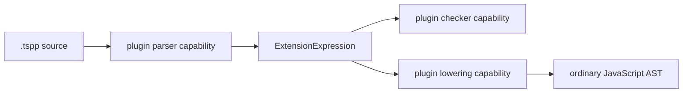

# TSPP feature plugin framework

TSPP features are complete capsules. Feature-specific compiler, language
service, LSP, and editor code belongs to the feature package; core packages own
only loading, composition, transport, and stable SDK contracts.

```mermaid
flowchart LR
    Config[tsconfig.json plugins] --> Resolver[package resolution]
    Resolver --> CompilerHost[compiler facet host]
    Resolver --> LSHost[language-service facet host]
    Resolver --> LSPHost[optional LSP facet host]
    Resolver --> EditorBuild[optional editor contribution builder]

    Feature[feature package] --> SDK[@tspp/plugin-sdk]
    Feature --> CompilerHost
    Feature --> LSHost
    Feature --> LSPHost
    Feature --> EditorBuild

    CompilerHost --> Compiler[TSPP compiler]
    LSHost --> Server[TSPP tsserver]
    LSPHost --> LSP[typescript-language-server]
    EditorBuild --> Editor[VS Code extension]
```

## Ownership rule

> Feature code belongs to the feature package, shared mechanisms belong to the
> core, integration shapes belong to the SDK, and loading and composition belong
> to the host.

A feature package may expose four facets:

- `compiler`: parsing, checking, diagnostics, and lowering;
- `languageService`: feature-specific completions, hovers, refactors, and other
  capabilities not already derived by the standard TypeScript language service;
- `lsp`: optional capabilities that cannot be represented by tsserver;
- `editor`: optional static editor metadata such as commands and snippets.

Plugins depend on `@tspp/plugin-sdk`, never compiler internals or another
feature implementation. Hosts load only the facet they own.

## Project declaration

The first vertical slice uses the existing `compilerOptions.plugins` array as
the single executable capability declaration:

```json
{
  "compilerOptions": {
    "plugins": [
      {
        "name": "@tspp/plugin-let-in-expression",
        "tspp": true
      }
    ]
  }
}
```

The `tspp` marker distinguishes a feature capsule from an ordinary TypeScript
language-service plugin. Both the TSPP compiler CLI and TSPP tsserver resolve that package from the
project. The compiler activates its compiler facet before parsing project source
files. Tsserver activates the same facet before constructing the configured
project, then ordinary TypeScript language-service features operate on the
resulting AST, symbols, and types.

`typescript-language-server` remains a generic LSP-to-tsserver bridge and the
VS Code extension remains a generic client. Neither contains a `let-in` branch.

## First feature capsule

`@tspp/plugin-let-in-expression` proves the compiler boundary. It owns the
lookahead, parse shape, type result, and lowering of `let x = value in body`.
The compiler sees only a generic `ExtensionExpression` carrying the plugin ID
and ordered child nodes.



## Rules

- no feature ID conditionals in compiler, tsserver, LSP, or editor code;
- no plugin-to-plugin implementation imports;
- no compiler-internal imports from feature packages;
- registrations return disposers and are owned by a host lifecycle;
- duplicate IDs and incompatible API versions fail at activation;
- plugin packages are resolved from the declaring project;
- standard language-service behavior is reused instead of reimplemented;
- new SDK ports require a concrete feature consumer.

## Asynchronous program analysis

Complex features register a `TSPPProgramAnalyzer`. The compiler snapshots root
source files into an immutable, compiler-neutral tree and awaits analyzers before
choosing the CLI exit status. An analyzer never receives a `Program`, checker,
compiler node, host, or filesystem capability.

`@tspp/plugin-formal-verification` is the first consumer. It owns proof-point
discovery, SMT lowering, Z3 worker isolation, timeouts, and diagnostics; the
compiler owns only snapshotting, scheduling, and diagnostic transport.

### Length-preserving source projections

Syntax that can be erased before ordinary TypeScript parsing uses a registered
source preprocessor. A preprocessor may replace characters but must preserve
the exact UTF-16 length and every line break. The host retains the original text
for plugin analysis while the upstream parser, checker, language service, and
emitter see the projection. This lets formal contracts remain entirely inside
their feature capsule without adding contract-specific AST fields to TypeScript.

Tsserver caches analyzer results per `Program`. Completion of an asynchronous
analysis requests the existing project diagnostic refresh; the generic LSP
bridge then publishes the merged semantic diagnostics normally.

### Declaration extensions

Declaration plugins register a contextual start-token parser and return an
ordinary upstream declaration node. The host records plugin ownership out of
band, so the binder, checker, and TypeScript transformer can delegate only the
extension-specific binding, declared/value type, and runtime lowering without
adding a feature-specific syntax kind. The SDK exposes opaque type-building
primitives; plugin packages never receive compiler nodes or symbol tables.

## Current process boundary

Compiler syntax registration is process-wide because the upstream TypeScript
parser is process-global. The first slice therefore supports one accumulated
feature set per tsserver process. True project isolation requires the LSP host
to group projects by plugin set and run separate tsserver processes, or a later
compiler change that threads a plugin context through parsing. This limitation
is explicit; feature packages themselves must not work around it with globals.
